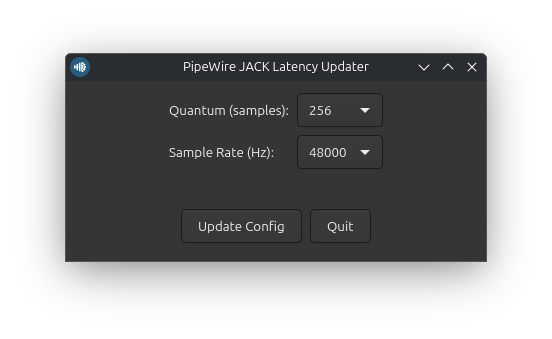

# pipewire-configurator

A simple GTK4 application written in Rust for Debian to configure PipeWire quantum and sample rate.



## Status

[](https://raw.githubusercontent.com/rolodoom/pipewire-configurator/master/LICENSE)

## Features

- Configure PipeWire quantum using a dropdown selector.
- Configure PipeWire sample rate using a dropdown selector.
- Read the currently applied quantum and sample rate when the application starts.
- Apply settings directly through `pw-metadata`.

## Installation

Download the latest `.deb` package from [GitHub Releases](https://github.com/rolodoom/pipewire-configurator/releases) and install it:

```bash
sudo apt install ./pipewire-configurator_*.deb
```

## Dependencies

```bash
sudo apt install pkg-config libgtk-4-dev
```

You also need the Rust toolchain and Cargo.

## Build

The `build.sh` script builds the release binary and generates the Debian package in `target/release/`.

It requires `python3` and `cargo-deb`.

```bash
cargo install cargo-deb
./build.sh
```

## Bugs and Issues

Have a bug or an issue with this template? [Open a new issue](https://github.com/rolodoom/pipewire-configurator/issues) here on GitHub.

## License

This code is released under the [GPL-3.0](https://github.com/rolodoom/pipewire-configurator/blob/master/LICENSE) license, which means you have the four freedoms to run, study, share, and modify the software. Any derivative work must be distributed under the same or equivalent license terms.
